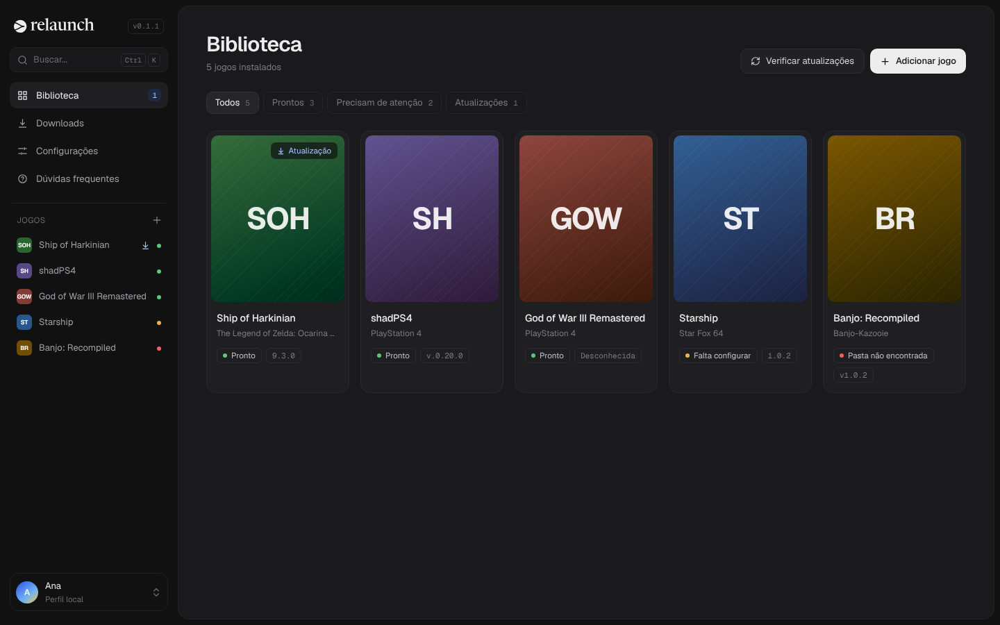
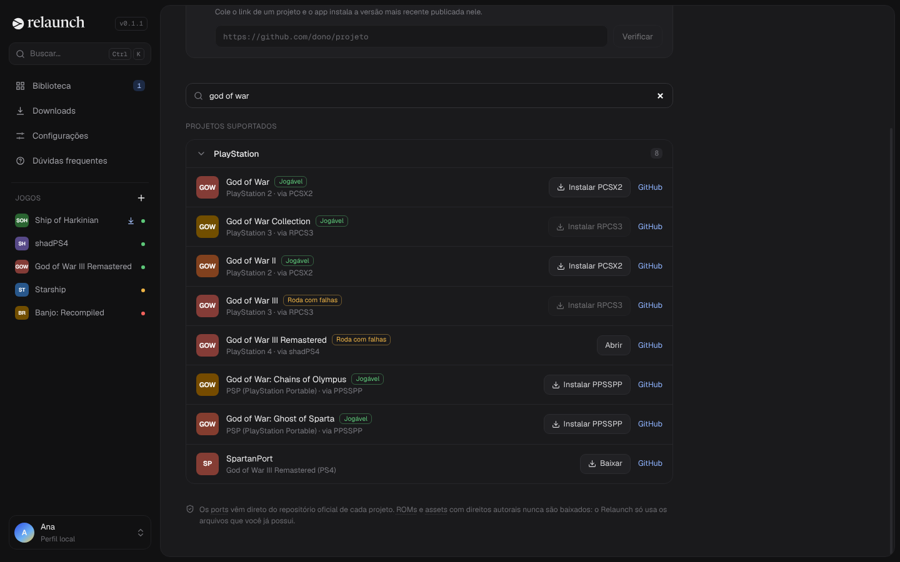
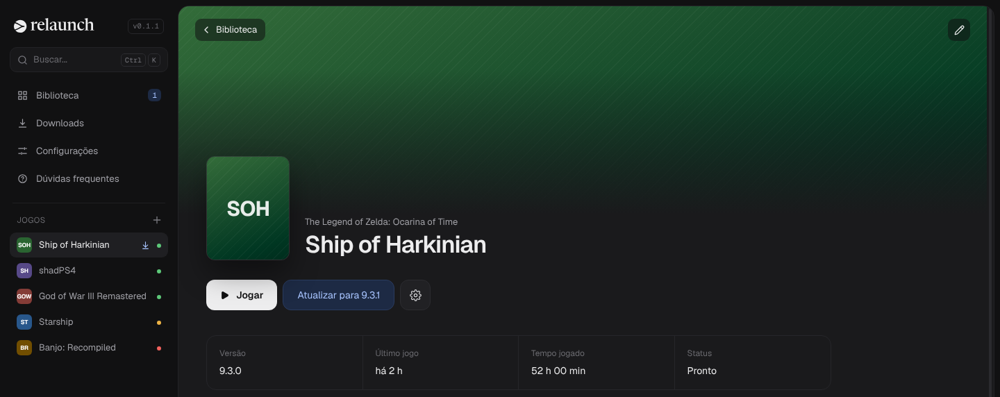
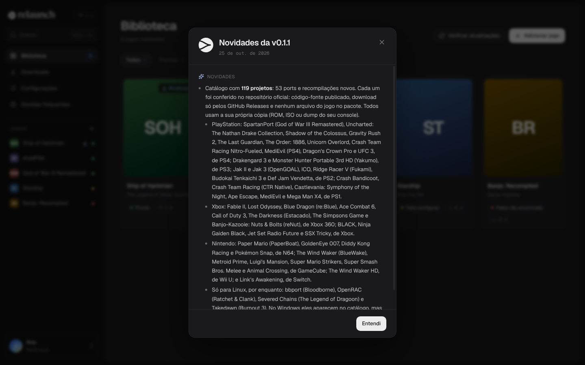

<h1>
  <picture>
    <source media="(prefers-color-scheme: dark)" srcset="docs/brand/relaunch-logo-white.svg">
    
  </picture>
</h1>

[](https://github.com/Silvamenu/Relaunch/actions/workflows/ci.yml)
[](https://github.com/Silvamenu/Relaunch/actions/workflows/security.yml)
[](https://github.com/Silvamenu/Relaunch/actions/workflows/codeql.yml)

**Seus ports favoritos, num só lugar.**

O Relaunch é um launcher para Windows e Linux que reúne os **ports e recompilações de jogos feitos por fãs**: Ship of Harkinian, Zelda 64: Recompiled, Starship e outros. Ele baixa o port do repositório oficial (ou usa o que você já instalou), mostra o que falta configurar, abre o jogo e mantém tudo atualizado a partir dos releases oficiais de cada projeto. A interface está em português (Brasil) e em inglês.



> [!IMPORTANT]
> O Relaunch **nunca** baixa, distribui ou embute ROMs, assets ou qualquer arquivo com direitos autorais. Ele só usa arquivos que você já possui, e só baixa os binários publicados pelos próprios projetos, direto do repositório declarado no manifesto, via HTTPS.

## Sumário

- **Para jogar:** [Início rápido](#início-rápido) · [Jogos suportados](#jogos-suportados) · [O que o Relaunch faz](#o-que-o-relaunch-faz) · [Atualizações](#atualizações) · [Onde ficam seus dados](#onde-ficam-seus-dados)
- **Para contribuir:** [Criar um manifesto](#criar-um-manifesto) · [Desenvolvimento](#desenvolvimento) · [Publicar uma versão do launcher](#publicar-uma-versão-do-launcher) · [Qualidade e segurança](#qualidade-e-segurança) · [Contribuir](#contribuir)
- [Créditos](#créditos) · [Licença](#licença)

## Início rápido

### Para jogar

1. **Instale o Relaunch.** Baixe o `Relaunch-Setup-<versão>.exe` na página de [Releases](https://github.com/Silvamenu/Relaunch/releases) e execute. O instalador deixa escolher a pasta e cria atalhos na área de trabalho e no menu Iniciar.
2. **Crie seu perfil.** Na tela **Quem está jogando?**, escolha um nome e uma cor; o PIN de 4 dígitos é opcional. Tudo fica só neste computador.
3. **Adicione o jogo.** Em **Adicionar jogo**, clique em **Baixar** ao lado do projeto para instalar a versão mais recente, direto do repositório oficial, numa pasta que você escolhe. Se o port já está instalado, use **Escolher pasta…** e aponte a pasta dele: o app reconhece o projeto sozinho.
4. **Siga o checklist** da aba **Configuração**: por exemplo, selecionar a sua ROM ou abrir o jogo uma vez para gerar os assets. Não sabe o que é uma ROM? Passe o mouse sobre os termos sublinhados com pontinhos para ver uma explicação.
5. **Clique em Jogar.**

O instalador não é assinado digitalmente, então o Windows SmartScreen pode avisar na primeira execução (**Mais informações → Executar assim mesmo**).

> [!NOTE]
> Os releases trazem só o instalador do Windows. No Linux, gere o app a partir do código: veja abaixo e [Gerar o instalador](#gerar-o-instalador).

### Para rodar a partir do código

```bash
git clone https://github.com/Silvamenu/Relaunch.git
cd Relaunch
npm install     # também baixa o binário do Electron
npm run dev     # abre o app com recarregamento automático da interface
npm run check   # tipos + lint + formatação + testes; rode antes de todo push
```

Para gerar o app instalável: `npm run dist` (instalador do Windows) ou `npm run dist:linux` (AppImage). Todos os comandos estão em [Scripts](#scripts).

### Requisitos

| Para                                   | Você precisa de                                                                                    |
| -------------------------------------- | -------------------------------------------------------------------------------------------------- |
| Jogar                                  | Windows 10/11 (prioridade) ou Linux e os seus próprios arquivos que o port pedir (como a sua ROM). |
| Desenvolver                            | Node.js **22.12 ou mais recente** (veja `.nvmrc`) e npm.                                           |
| Gerar o instalador do Windows no Linux | Wine, incluindo o de 32 bits (`wine32`).                                                           |

## Jogos suportados

O app traz **119 projetos** em listas por plataforma, as mesmas da tela **Adicionar jogo**, com busca. Há três tipos:

- **Port ou recompilação**: o jogo refeito para rodar direto no PC. O app baixa o port do repositório oficial; o conteúdo do jogo vem da sua ROM ou do seu disco.
- **Emulador**: o programa que imita o console. O app instala o emulador uma vez, do repositório oficial dele.
- **Jogo via emulador**: jogos grandes de console (como **God of War III Remastered**). O app abre o emulador com o **seu** jogo, o dump da sua cópia. O selo mostra quão bem ele roda hoje, pela lista de compatibilidade oficial do emulador: **Jogável**, **Roda com falhas** ou **Experimental**.



> [!NOTE]
> O Relaunch nunca baixa jogos, ROMs, BIOS ou firmware. Os jogos via emulador pedem um PC forte (processador recente e placa de vídeo com Vulkan).

<details>
<summary><strong>Nintendo</strong> (27)</summary>

| Projeto                                                                              | Jogo original                                  | Como roda                                             |
| ------------------------------------------------------------------------------------ | ---------------------------------------------- | ----------------------------------------------------- |
| [2 Ship 2 Harkinian](https://github.com/2ship2harkinian/2ship2harkinian)             | The Legend of Zelda: Majora's Mask             | Port nativo · instalação pelo app (Windows e Linux)   |
| [Animal Crossing PC Port](https://github.com/flyngmt/ACGC-PC-Port)                   | Animal Crossing (GameCube)                     | Port nativo · instalação pelo app (Windows)           |
| [Banjo: Recompiled](https://github.com/BanjoRecomp/BanjoRecomp)                      | Banjo-Kazooie                                  | Port nativo · instalação pelo app (Windows e Linux)   |
| [BlueWake](https://github.com/chrissotraidis/bluewake)                               | The Legend of Zelda: The Wind Waker (GameCube) | Port nativo · instalação pelo app (Windows)           |
| [DKR-R (Diddy Kong Racing Recompiled)](https://github.com/ThatGuyMcd/DKR-R)          | Diddy Kong Racing (N64)                        | Port nativo · instalação pelo app (Windows e Linux)   |
| [Donkey Kong 64: Recompiled](https://github.com/Rainchus/Donkey-Kong-64-Recompiled)  | Donkey Kong 64                                 | Port nativo · instalação pelo app (Windows e Linux)   |
| [Dusklight](https://github.com/TwilitRealm/dusklight)                                | The Legend of Zelda: Twilight Princess         | Port nativo · instalação pelo app (Windows e Linux)   |
| [GoldenEye 007 PC Port](https://github.com/jkdansereau/goldeneye-pc-port)            | GoldenEye 007 (N64)                            | Port nativo · instalação pelo app (Windows e Linux)   |
| [LAS Recomp](https://github.com/peiikai/LASRecomp)                                   | The Legend of Zelda: Link's Awakening (Switch) | Port nativo · instalação pelo app (Windows e Linux)   |
| [Luigi's Mansion Recompiled](https://github.com/rob646464/luigis-mansion-recompiled) | Luigi's Mansion (GameCube)                     | Port nativo · instalação pelo app (Windows e Linux)   |
| Mario Kart 8                                                                         | Nintendo Wii U                                 | via Cemu · Jogável                                    |
| [melee-pc](https://github.com/999sian/melee-pc)                                      | Super Smash Bros. Melee (GameCube)             | Port nativo · instalação pelo app (Windows e Linux)   |
| [MetroidPrimePort](https://github.com/Odrannnn/MetroidPrimePort)                     | Metroid Prime (GameCube)                       | Port nativo · instalação pelo app (Windows e Linux)   |
| [PaperBoat](https://github.com/HarbourMasters/PaperBoat)                             | Paper Mario (N64)                              | Port nativo · instalação pelo app (Windows e Linux)   |
| [Perfect Dark (PC Port)](https://github.com/perfect-dark-pc-port/perfect_dark)       | Perfect Dark                                   | Port nativo · instalação pelo app (Windows e Linux)   |
| [Ship of Harkinian](https://github.com/HarbourMasters/Shipwright)                    | The Legend of Zelda: Ocarina of Time           | Port nativo · instalação pelo app (Windows e Linux)   |
| [Snap64 Recomp](https://github.com/JackandBeans/Snap64Recomp)                        | Pokémon Snap (N64)                             | Port nativo · instalação pelo app (Windows e Linux)   |
| [SpaghettiKart](https://github.com/HarbourMasters/SpaghettiKart)                     | Mario Kart 64                                  | Port nativo · instalação pelo app (Windows e Linux)   |
| [Starship](https://github.com/HarbourMasters/Starship)                               | Star Fox 64                                    | Port nativo · instalação pelo app (Windows e Linux)   |
| [Strikers](https://github.com/new-coke/strikers)                                     | Super Mario Strikers (GameCube)                | Port nativo · instalação pelo app (Windows e Linux)   |
| Super Mario 3D World                                                                 | Nintendo Wii U                                 | via Cemu · Jogável                                    |
| [Super Mario 64 PC Port](https://github.com/sm64-port/sm64-port)                     | Super Mario 64                                 | Port nativo · instale pelo projeto e adicione a pasta |
| The Legend of Zelda: Breath of the Wild                                              | Nintendo Wii U                                 | via Cemu · Jogável                                    |
| Xenoblade Chronicles X                                                               | Nintendo Wii U                                 | via Cemu · Jogável                                    |
| [Zelda 64: Recompiled](https://github.com/Zelda64Recomp/Zelda64Recomp)               | The Legend of Zelda: Majora's Mask             | Port nativo · instalação pelo app (Windows e Linux)   |
| [Zelda Wind Waker HD Recomp](https://github.com/ZeldaWWHDRecomp/ZeldaWWHDRecomp)     | The Legend of Zelda: The Wind Waker HD (Wii U) | Port nativo · instalação pelo app (Windows e Linux)   |
| [Zelda3](https://github.com/snesrev/zelda3)                                          | The Legend of Zelda: A Link to the Past        | Port nativo · instalação pelo app (Windows)           |

</details>

<details>
<summary><strong>PlayStation</strong> (50)</summary>

| Projeto                                                                                         | Jogo original                                | Como roda                                           |
| ----------------------------------------------------------------------------------------------- | -------------------------------------------- | --------------------------------------------------- |
| [Ape Escape Recompiled](https://github.com/mstan/ApeEscapeRecomp)                               | Ape Escape (PS1)                             | Port nativo · instalação pelo app (Windows e Linux) |
| [bbport](https://github.com/deadinside28/bloodborne_pc)                                         | Bloodborne (PS4)                             | Port nativo · instalação pelo app (Linux)           |
| Bloodborne                                                                                      | PlayStation 4                                | via shadPS4 · Roda com falhas                       |
| [Crash Bandicoot Launcher](https://github.com/Matteo842/CrashBandicoot-Launcher)                | Crash Bandicoot (PS1)                        | Port nativo · instalação pelo app (Windows)         |
| [CTR Native](https://github.com/CTR-tools/ctr-native)                                           | Crash Team Racing (PS1)                      | Port nativo · instalação pelo app (Windows e Linux) |
| [CTR-NitroFueled-PC](https://github.com/GetLostIn/CTR-NitroFueled-PC)                           | Crash Team Racing Nitro-Fueled (PS4)         | Port nativo · instalação pelo app (Windows)         |
| Dark Souls                                                                                      | PlayStation 3                                | via RPCS3 · Jogável                                 |
| [Def Jam Vendetta Recompiled](https://github.com/jcsix694/def-jam-vendetta-recomp)              | Def Jam Vendetta (PS2)                       | Port nativo · instalação pelo app (Windows)         |
| Demon's Souls                                                                                   | PlayStation 3                                | via RPCS3 · Jogável                                 |
| [Dragon's Crown Pro PC Port](https://github.com/saulob/dragons-crown-pro-pc)                    | Dragon's Crown Pro (PS4)                     | Port nativo · instalação pelo app (Windows e Linux) |
| [Drakengard 3 Recompiled](https://github.com/soyjxck/dod3-recomp)                               | Drakengard 3 (PS3)                           | Port nativo · instalação pelo app (Windows)         |
| Final Fantasy VII                                                                               | PlayStation (PS1)                            | via DuckStation · Jogável                           |
| Final Fantasy VIII Remastered                                                                   | PlayStation 4                                | via shadPS4 · Jogável                               |
| Final Fantasy X                                                                                 | PlayStation 2                                | via PCSX2 · Jogável                                 |
| [Fukami](https://github.com/danisandoval/fukami)                                                | Ridge Racer V (PS2)                          | Port nativo · instalação pelo app (Windows e Linux) |
| God of War                                                                                      | PlayStation 2                                | via PCSX2 · Jogável                                 |
| God of War Collection                                                                           | PlayStation 3                                | via RPCS3 · Jogável                                 |
| God of War II                                                                                   | PlayStation 2                                | via PCSX2 · Jogável                                 |
| God of War III                                                                                  | PlayStation 3                                | via RPCS3 · Roda com falhas                         |
| God of War III Remastered                                                                       | PlayStation 4                                | via shadPS4 · Roda com falhas                       |
| God of War: Chains of Olympus                                                                   | PSP (PlayStation Portable)                   | via PPSSPP · Jogável                                |
| God of War: Ghost of Sparta                                                                     | PSP (PlayStation Portable)                   | via PPSSPP · Jogável                                |
| [Gravity Rush 2 PC](https://github.com/HayatoG/gr2_pc)                                          | Gravity Rush 2 (PS4)                         | Port nativo · instalação pelo app (Windows e Linux) |
| [ico-pc](https://github.com/nathanialf/ico-pc)                                                  | ICO (PS2)                                    | Port nativo · instalação pelo app (Windows e Linux) |
| [MediEvil (PS4) for PC](https://github.com/bc160201983/medievil_2019_pc_port)                   | MediEvil (PS4, 2019)                         | Port nativo · instalação pelo app (Windows)         |
| [MediEvil Recomp](https://github.com/BlackLabelHQ/MediEvilRecomp)                               | MediEvil (PS1)                               | Port nativo · instalação pelo app (Windows e Linux) |
| [Mega Man X4 Recompiled](https://github.com/mstan/MegaManX4Recomp)                              | Mega Man X4 (PS1)                            | Port nativo · instalação pelo app (Windows e Linux) |
| Metal Gear Rising: Revengeance                                                                  | PlayStation 3                                | via RPCS3 · Jogável                                 |
| Metal Gear Solid                                                                                | PlayStation (PS1)                            | via DuckStation · Jogável                           |
| Metal Gear Solid 3: Snake Eater                                                                 | PlayStation 2                                | via PCSX2 · Jogável                                 |
| Need for Speed: Hot Pursuit Remastered                                                          | PlayStation 4                                | via shadPS4 · Jogável                               |
| [OpenGOAL: Jak 3](https://github.com/open-goal/jak-project)                                     | Jak 3 (PS2)                                  | Port nativo · instalação pelo app (Windows e Linux) |
| [OpenGOAL: Jak and Daxter](https://github.com/open-goal/jak-project)                            | Jak and Daxter: The Precursor Legacy (PS2)   | Port nativo · instalação pelo app (Windows e Linux) |
| [OpenGOAL: Jak II](https://github.com/open-goal/jak-project)                                    | Jak II (PS2)                                 | Port nativo · instalação pelo app (Windows e Linux) |
| [OpenRAC](https://github.com/OpenRAC/OpenRAC)                                                   | Ratchet & Clank (PS2)                        | Port nativo · instalação pelo app (Linux)           |
| [REDRIVER2](https://github.com/OpenDriver2/REDRIVER2)                                           | Driver 2 (PlayStation)                       | Port nativo · instalação pelo app (Windows)         |
| Resident Evil 2                                                                                 | PlayStation (PS1)                            | via DuckStation · Jogável                           |
| [Severed Chains](https://github.com/Legend-of-Dragoon-Modding/Severed-Chains)                   | The Legend of Dragoon (PS1)                  | Port nativo · instalação pelo app (Linux)           |
| Shadow of the Colossus                                                                          | PlayStation 2                                | via PCSX2 · Jogável                                 |
| [Shadow of the Colossus PC](https://github.com/AjncSystem/ShadowOfTheColossus-PC)               | Shadow of the Colossus (PS4)                 | Port nativo · instalação pelo app (Windows)         |
| [SpartanPort](https://github.com/FelipePrado0/SpartanPort)                                      | God of War III Remastered (PS4)              | Port nativo · instalação pelo app (Windows e Linux) |
| [SymphonyRecomp](https://github.com/BlackLabelHQ/SymphonyRecomp)                                | Castlevania: Symphony of the Night (PS1)     | Port nativo · instalação pelo app (Windows e Linux) |
| [Tenkaichi3Decomp](https://github.com/z3xox/Tenkaichi3Decomp)                                   | Dragon Ball Z: Budokai Tenkaichi 3 (PS2)     | Port nativo · instalação pelo app (Windows e Linux) |
| [The Last Guardian PC](https://github.com/HayatoG/tlg_pc)                                       | The Last Guardian (PS4)                      | Port nativo · instalação pelo app (Windows e Linux) |
| [The Order: 1886 PC Native Port](https://github.com/mateussmeneses/theorder1886-port)           | The Order: 1886 (PS4)                        | Port nativo · instalação pelo app (Windows)         |
| [UFC 3 native port](https://github.com/GNSB/UFC-3-PS4-PORT-LINUX-WINDOWS)                       | EA Sports UFC 3 (PS4)                        | Port nativo · instalação pelo app (Windows e Linux) |
| [Uncharted: The Nathan Drake Collection for Windows](https://github.com/Supermedo/uncharted_pc) | Uncharted: The Nathan Drake Collection (PS4) | Port nativo · instalação pelo app (Windows)         |
| [Unicorn Overlord PC (vwport)](https://github.com/hachi23/unicorn_overlord_pc)                  | Unicorn Overlord (PS4)                       | Port nativo · instalação pelo app (Windows e Linux) |
| [Yakumo](https://github.com/TeamGDB/Yakumo)                                                     | Monster Hunter Portable 3rd HD Ver. (PS3)    | Port nativo · instalação pelo app (Windows e Linux) |
| Yakuza 0                                                                                        | PlayStation 4                                | via shadPS4 · Roda com falhas                       |

</details>

<details>
<summary><strong>Xbox</strong> (18)</summary>

| Projeto                                                                               | Jogo original                                | Como roda                                           |
| ------------------------------------------------------------------------------------- | -------------------------------------------- | --------------------------------------------------- |
| [AC6Recomp](https://github.com/sal063/AC6_recomp)                                     | Ace Combat 6: Fires of Liberation (Xbox 360) | Port nativo · instalação pelo app (Windows)         |
| [Black - XBE Recomp](https://github.com/TGP482/BLACK-XBERecomp)                       | Black (Xbox)                                 | Port nativo · instalação pelo app (Windows)         |
| [CoD3Recomp](https://github.com/FrankHUN88453/CoD3Recomp)                             | Call of Duty 3 (Xbox 360)                    | Port nativo · instalação pelo app (Windows)         |
| [Estacado](https://github.com/invinceble55-wq/Estacado-The-Darkness-Recomp)           | The Darkness (Xbox 360)                      | Port nativo · instalação pelo app (Windows)         |
| [Fable 2 Recompiled](https://github.com/himdo/Fable-2-Recomp)                         | Fable II (Xbox 360)                          | Port nativo · instalação pelo app (Windows)         |
| Gears of War 2                                                                        | Xbox 360                                     | via Xenia Canary · Jogável                          |
| Gears of War 3                                                                        | Xbox 360                                     | via Xenia Canary · Jogável                          |
| Halo 3                                                                                | Xbox 360                                     | via Xenia Canary · Jogável                          |
| [JSRF Unleashed](https://github.com/JuMatt/JetSetRadioFuture-Unleashed)               | Jet Set Radio Future (Xbox)                  | Port nativo · instalação pelo app (Windows e Linux) |
| [Lost Odyssey Recomp](https://github.com/freefrank/LostOdysseyRecomp)                 | Lost Odyssey (Xbox 360)                      | Port nativo · instalação pelo app (Windows e Linux) |
| [Ninja Gaiden Black Recompiled](https://github.com/gamboozino/ngbrecomp)              | Ninja Gaiden Black (Xbox)                    | Port nativo · instalação pelo app (Windows e Linux) |
| [re:Blue](https://github.com/zolaware/reblue)                                         | Blue Dragon (Xbox 360)                       | Port nativo · instalação pelo app (Windows e Linux) |
| Red Dead Redemption                                                                   | Xbox 360                                     | via Xenia Canary · Jogável                          |
| [reNut](https://github.com/masterspike52/reNut)                                       | Banjo-Kazooie: Nuts & Bolts (Xbox 360)       | Port nativo · instalação pelo app (Windows e Linux) |
| [SSX Tricky: PC Port](https://github.com/MatiasRiveraC/SSX-Tricky-PC)                 | SSX Tricky (Xbox)                            | Port nativo · instalação pelo app (Windows)         |
| [Takedawn](https://github.com/xenophobentx/takedawn)                                  | Burnout 3: Takedown (Xbox)                   | Port nativo · instalação pelo app (Linux)           |
| [The Simpsons Game Recompiled](https://github.com/YesterMester/TheSimpsonsGameRecomp) | The Simpsons Game (Xbox 360, 2007)           | Port nativo · instalação pelo app (Windows e Linux) |
| [Unleashed Recompiled](https://github.com/hedge-dev/UnleashedRecomp)                  | Sonic Unleashed (Xbox 360)                   | Port nativo · instalação pelo app (Windows)         |

</details>

<details>
<summary><strong>Sega</strong> (2)</summary>

| Projeto                                                                                | Jogo original                   | Como roda                                           |
| -------------------------------------------------------------------------------------- | ------------------------------- | --------------------------------------------------- |
| [Sonic 3 A.I.R.](https://github.com/Eukaryot/sonic3air)                                | Sonic 3 & Knuckles (Mega Drive) | Port nativo · instalação pelo app (Windows e Linux) |
| [Sonic CD (RSDKv3 Decompilation)](https://github.com/RSDKModding/RSDKv3-Decompilation) | Sonic CD (Sega CD)              | Port nativo · instalação pelo app (Windows e Linux) |

</details>

<details>
<summary><strong>PC clássicos</strong> (15)</summary>

| Projeto                                                                   | Jogo original                    | Como roda                                             |
| ------------------------------------------------------------------------- | -------------------------------- | ----------------------------------------------------- |
| [Arx Libertatis](https://github.com/arx/ArxLibertatis)                    | Arx Fatalis                      | Port nativo · instalação pelo app (Windows e Linux)   |
| [Augustus](https://github.com/Keriew/augustus)                            | Caesar III                       | Port nativo · instalação pelo app (Windows e Linux)   |
| [CorsixTH](https://github.com/CorsixTH/CorsixTH)                          | Theme Hospital                   | Port nativo · instalação pelo app (Windows e Linux)   |
| [Daggerfall Unity](https://github.com/Interkarma/daggerfall-unity)        | The Elder Scrolls II: Daggerfall | Port nativo · instalação pelo app (Windows e Linux)   |
| [DevilutionX](https://github.com/diasurgical/devilutionX)                 | Diablo e Diablo: Hellfire        | Port nativo · instalação pelo app (Windows e Linux)   |
| [dhewm 3](https://github.com/dhewm/dhewm3)                                | Doom 3 e Resurrection of Evil    | Port nativo · instalação pelo app (Windows e Linux)   |
| [Fallout 2 Community Edition](https://github.com/alexbatalov/fallout2-ce) | Fallout 2                        | Port nativo · instalação pelo app (Windows e Linux)   |
| [Fallout Community Edition](https://github.com/alexbatalov/fallout1-ce)   | Fallout                          | Port nativo · instalação pelo app (Windows e Linux)   |
| [fheroes2](https://github.com/ihhub/fheroes2)                             | Heroes of Might and Magic II     | Port nativo · instalação pelo app (Windows e Linux)   |
| [FreeSpace 2 Open](https://github.com/scp-fs2open/fs2open.github.com)     | FreeSpace 2                      | Port nativo · instalação pelo app (Windows e Linux)   |
| [Julius](https://github.com/bvschaik/julius)                              | Caesar III                       | Port nativo · instalação pelo app (Windows e Linux)   |
| [OpenMW](https://github.com/OpenMW/openmw)                                | The Elder Scrolls III: Morrowind | Port nativo · instale pelo projeto e adicione a pasta |
| [OpenRCT2](https://github.com/OpenRCT2/OpenRCT2)                          | RollerCoaster Tycoon 2           | Port nativo · instalação pelo app (Windows e Linux)   |
| [UZDoom](https://github.com/UZDoom/UZDoom)                                | DOOM e DOOM II                   | Port nativo · instalação pelo app (Windows e Linux)   |
| [vkQuake](https://github.com/Novum/vkQuake)                               | Quake                            | Port nativo · instalação pelo app (Windows e Linux)   |

</details>

<details>
<summary><strong>Emuladores</strong> (7)</summary>

| Projeto                                                      | Jogo original              | Como roda                             |
| ------------------------------------------------------------ | -------------------------- | ------------------------------------- |
| [Cemu](https://github.com/cemu-project/Cemu)                 | Nintendo Wii U             | Instalação pelo app (Windows e Linux) |
| [DuckStation](https://github.com/stenzek/duckstation)        | PlayStation (PS1)          | Instalação pelo app (Windows e Linux) |
| [PCSX2](https://github.com/PCSX2/pcsx2)                      | PlayStation 2              | Instalação pelo app (Windows e Linux) |
| [PPSSPP](https://github.com/hrydgard/ppsspp)                 | PSP (PlayStation Portable) | Instalação pelo app (Windows e Linux) |
| [RPCS3](https://github.com/RPCS3/rpcs3)                      | PlayStation 3              | Instalação pelo app (Windows)         |
| [shadPS4](https://github.com/shadps4-emu/shadPS4)            | PlayStation 4              | Instalação pelo app (Windows e Linux) |
| [Xenia Canary](https://github.com/xenia-canary/xenia-canary) | Xbox 360                   | Instalação pelo app (Windows e Linux) |

</details>

Falta algum? Cada jogo é um arquivo JSON, sem mexer no código: veja [Criar um manifesto](#criar-um-manifesto), cole o link do repositório em **Adicionar jogo → Instalar de um repositório do GitHub** ou peça com o modelo de issue [Suporte a um novo jogo](https://github.com/Silvamenu/Relaunch/issues/new/choose).

## O que o Relaunch faz

| Área                        | O que faz                                                                                                                                                                                                                                                                                                                                                               |
| --------------------------- | ----------------------------------------------------------------------------------------------------------------------------------------------------------------------------------------------------------------------------------------------------------------------------------------------------------------------------------------------------------------------- |
| **Biblioteca**              | Grade com o status de cada jogo (**Pronto**, **Falta configurar**, **Pasta não encontrada**), filtros e busca rápida com `Ctrl+K`.                                                                                                                                                                                                                                      |
| **Perfis**                  | Tela **Quem está jogando?** ao abrir: perfis locais com cor e PIN opcional, que podem ir para outro computador num arquivo `.relaunch`. Nada vai para a internet.                                                                                                                                                                                                       |
| **Adicionar jogo**          | Catálogo em listas por plataforma (Nintendo, PlayStation, Xbox, Sega, PC, Emuladores), com busca. **Baixar** instala o port do repositório oficial; nos jogos via emulador, o app instala o emulador e você escolhe o seu jogo. Também aceita o link de um repositório do GitHub (última versão), ou a pasta de um port já instalado.                                   |
| **Página do jogo**          | Abas **Configuração**, **Arquivos de config**, **Atualizações** e **Sobre**. Pelo menu do jogo: renomear, trocar a pasta, voltar à capa ou ao banner padrão e remover da biblioteca (os arquivos do jogo não são apagados).                                                                                                                                             |
| **Checklist**               | Requisitos com ✓/✗ e ações: selecionar a sua ROM (validada por tamanho ou SHA-1), copiá-la para a pasta do jogo, abrir a pasta, abrir o jogo pela primeira vez e ver instruções. Termos como ROM e SHA-1 têm uma dica que explica o que são.                                                                                                                            |
| **Editor de configs**       | Arquivos JSON, INI e texto, editáveis em formulário ou como texto. Valida antes de salvar, faz backup automático e permite restaurar.                                                                                                                                                                                                                                   |
| **Jogar**                   | Abre o executável com a pasta do jogo como diretório de trabalho, mais os argumentos e variáveis de ambiente do manifesto. O jogo conta como aberto enquanto algum programa da pasta dele roda (ports que abrem um launcher próprio antes do jogo). O Relaunch se minimiza e volta para a frente quando o último jogo fecha. Registra o último acesso e o tempo jogado. |
| **Controle**                | Navegação pelo app inteiro com controle (o de Xbox é o mais garantido): direcional ou analógico esquerdo movem a seleção, com uma borda azul, **A** confirma e **B** fecha a janela ou o menu aberto ou volta uma página. O mouse esconde a borda, e o controle é ignorado enquanto a janela do Relaunch não está na frente.                                            |
| **Capa e banner**           | Gerados com a cor do manifesto, ou imagens escolhidas por você: clique no lápis do banner ou passe o mouse sobre a capa.                                                                                                                                                                                                                                                |
| **Atualizações dos jogos**  | Busca versões novas nos GitHub Releases de cada projeto, faz backup, preserva saves e volta sozinho se algo falhar. Veja [como funciona](#atualizações-dos-jogos).                                                                                                                                                                                                      |
| **Downloads**               | Atualizações em andamento, disponíveis e concluídas na sessão. O progresso também aparece na barra lateral.                                                                                                                                                                                                                                                             |
| **Atualização do launcher** | Baixa a versão nova do Relaunch em segundo plano e avisa com uma barra azul na barra lateral. Só instala quando você clica em **Atualizar**. Depois, o popup **Novidades** mostra o que mudou.                                                                                                                                                                          |
| **Dúvidas frequentes**      | Respostas sobre ROMs (o que são e como usar), SHA-1, jogos via emulador, instalar pelo link de um repositório, atualizações e saves, uso de controle, atualização do Relaunch, avisos do Windows, dados e PIN.                                                                                                                                                          |
| **Configurações**           | Tema escuro, claro ou do sistema; idioma (PT-BR padrão, EN); perfil; minimizar o Relaunch enquanto um jogo está aberto; token do GitHub; notificações; atualização automática por jogo; pastas de manifestos e de dados; reescanear pastas.                                                                                                                             |



## Atualizações

### Atualizações dos jogos

- O app consulta os GitHub Releases de cada projeto **ao abrir e a cada 3 horas** (dá para desligar em **Configurações**). Quando há versão nova, aparecem um badge e uma notificação do sistema.
- Para atualizar, use **Atualizar para…** na página do jogo, a aba **Atualizações** ou a página **Downloads**. Com **Atualizar automaticamente** ligado no jogo, as versões novas são instaladas sozinhas quando o jogo não está aberto.
- Saves, configurações, mods e arquivos gerados da sua ROM **não são sobrescritos** (lista `preserve` do manifesto).
- Antes de atualizar, o app faz um backup dos arquivos que o pacote vai substituir. Se algo falhar, ele restaura tudo sozinho. O botão **Voltar para a versão anterior** desfaz uma atualização concluída. Ao remover um jogo da biblioteca, os backups dele também são apagados.
- A versão instalada é a tag do release. Em jogos adicionados manualmente ela começa como "Desconhecida": informe a versão na aba **Atualizações** ou clique em **Já tenho a mais recente**.
- Projetos sem binários publicados (como o Super Mario 64 PC Port) mostram só o link do repositório.

<details>
<summary><strong>Passo a passo de uma atualização</strong></summary>

| #   | Etapa                         | O que acontece                                                                                                                                                             |
| --- | ----------------------------- | -------------------------------------------------------------------------------------------------------------------------------------------------------------------------- |
| 1   | Escolha do asset              | O app pega o arquivo do release que casa com o `assetPatterns` da plataforma.                                                                                              |
| 2   | Origem                        | Confere se a URL é `https://github.com/<repo do manifesto>/releases/download/…`. Redirecionamentos só são aceitos para a CDN de releases do GitHub.                        |
| 3   | Download                      | Baixa para uma pasta temporária, com progresso e cancelamento.                                                                                                             |
| 4   | Integridade                   | Confere o tamanho e o SHA-256, vindo do campo `digest` da API ou de um arquivo de checksums do release, quando existir.                                                    |
| 5   | Extração                      | Extrai zip, 7z ou tar (`.tar.gz`, `.tgz`, `.tar.bz2`). Uma pasta raiz única vira a raiz; um pacote dentro de outro (ex.: um `.tar.gz` dentro do `.zip`) também é extraído. |
| 6   | Jogo aberto                   | Se o jogo estiver rodando, o app pede para fechar.                                                                                                                         |
| 7   | Backup                        | Guarda em `backups/<id>/<versão>/backup.zip`, nos dados do app, os arquivos que o pacote vai substituir, e mantém os 2 mais recentes.                                      |
| 8   | Cópia                         | Copia os arquivos novos por cima, pulando o que casar com `preserve`. Cada arquivo é registrado antes de ser escrito.                                                      |
| 9   | Falha                         | Se algo der errado, os arquivos novos são removidos e os alterados voltam do backup automaticamente.                                                                       |
| 10  | Voltar para a versão anterior | Restaura o último backup sem sobrescrever saves e configs, e remove os arquivos que a atualização tinha adicionado.                                                        |

</details>

### Atualização do launcher

- Na versão instalada, o Relaunch procura versões novas dele mesmo **ao abrir e a cada 3 horas**, nos GitHub Releases deste repositório.
- A versão nova é baixada em segundo plano. Quando o download termina, uma **barra azul** aparece acima do seu perfil, na barra lateral, com o botão **Atualizar para a vX.Y.Z**.
- A atualização só é instalada quando você clica nesse botão. Fechar o app não instala nada: a barra continua lá até você decidir.
- Ao clicar, o app fecha, atualiza na mesma pasta sem mostrar as telas do instalador e abre de novo sozinho.
- Depois de atualizar, o popup **Novidades da vX.Y.Z** mostra as notas do `CHANGELOG.md`. Para rever, use **Configurações → Ver novidades**.



### Limite da API do GitHub

Sem login, a API do GitHub permite **60 consultas por hora**. O app usa ETag (`If-None-Match`) e reaproveita as respostas que não mudaram (`304`); com um token configurado, essas respostas `304` não contam no limite.

> [!TIP]
> Para mais folga, cole um **token pessoal do GitHub** em **Configurações**: o limite sobe para 5.000 consultas por hora. O token não precisa de nenhuma permissão especial, fica cifrado com o cofre do sistema quando ele está disponível (DPAPI no Windows) e nunca é devolvido à interface.

## Onde ficam seus dados

| Sistema | Pasta                |
| ------- | -------------------- |
| Windows | `%APPDATA%\Relaunch` |
| Linux   | `~/.config/Relaunch` |

| Item              | O que guarda                                                                    |
| ----------------- | ------------------------------------------------------------------------------- |
| `relaunch.json`   | Biblioteca, configurações e cache.                                              |
| `backups/`        | Backups feitos antes de cada atualização de jogo (os 2 mais recentes por jogo). |
| `config-backups/` | Backups dos arquivos de configuração salvos pelo editor (até 10 por arquivo).   |
| `covers/`         | Capas e banners que você escolheu para os jogos.                                |
| `manifests/`      | Seus manifestos, que adicionam ou substituem os embutidos.                      |

Abra essa pasta em **Configurações → Abrir pasta de dados do app**. Desinstalar o Relaunch não apaga esses dados.

> [!NOTE]
> O Relaunch se chamava **RecompHub**. Na primeira abertura com o nome novo, os dados da pasta antiga (`RecompHub`) são movidos para a pasta `Relaunch`. No Linux, o token do GitHub fica preso ao nome antigo no cofre do sistema: se ele sumir, cole-o de novo em **Configurações**.

## Criar um manifesto

Cada projeto suportado é descrito por um arquivo `manifests/<id>.json`. **Adicionar um jogo = adicionar um manifesto, sem mexer no código.**

- O nome do arquivo precisa ser igual ao `id`.
- Os manifestos embutidos ficam em [`manifests/`](manifests), e os testes (`npm test`) validam todos eles. Os manifestos reais são bons pontos de partida.
- Você também pode colocar manifestos na sua pasta de manifestos (**Configurações → Abrir pasta de manifestos**). Um manifesto seu com o mesmo `id` substitui o embutido.
- Use **Reescanear pastas** para recarregar sem reiniciar. Manifestos inválidos aparecem em **Configurações**, com o erro.

| Campo                      | Obrigatório | Para quê                                                                                       |
| -------------------------- | ----------- | ---------------------------------------------------------------------------------------------- |
| `id`                       | sim         | Letras minúsculas, números, `-` e `_`. Igual ao nome do arquivo.                               |
| `name`                     | sim         | Nome exibido.                                                                                  |
| `originalGame`             | não         | Jogo original.                                                                                 |
| `description`              | não         | Texto curto exibido na aba **Sobre**.                                                          |
| `repoUrl`                  | sim         | Repositório do projeto (HTTPS).                                                                |
| `website`                  | não         | Site oficial (HTTPS).                                                                          |
| `accentColor`              | não         | Cor da capa gerada, no formato `#RRGGBB`.                                                      |
| `category`                 | não         | Lista do catálogo: `nintendo`, `playstation`, `xbox`, `sega`, `pc`, `emulators` ou `custom`.   |
| `compatibility`            | não         | Quão bem roda hoje: `playable`, `ingame` ou `experimental`.                                    |
| `runner`                   | não         | Jogo que abre num emulador instalado pelo app. Veja [Jogos via emulador](#jogos-via-emulador). |
| `executables`              | sim\*       | Executáveis por plataforma.                                                                    |
| `detectFiles`              | sim\*       | Arquivos que identificam a pasta do projeto.                                                   |
| `requirements`             | não         | Itens do checklist da aba **Configuração**.                                                    |
| `configFiles`              | não         | Arquivos de configuração editáveis no app.                                                     |
| `launchArgs` / `launchEnv` | não         | Argumentos e variáveis de ambiente ao abrir o jogo.                                            |
| `updates`                  | não         | De onde vêm as atualizações. Sem ele, vale `{ "source": "none" }`.                             |
| `_todo` e chaves com `_`   | não         | Anotações ignoradas pelo app. O `_todo` aparece na página do jogo como pendência a confirmar.  |

\* Menos nos jogos com `runner`: quem tem executável é o emulador.

<details>
<summary><strong>Exemplo comentado (Ship of Harkinian)</strong></summary>

```jsonc
{
  "id": "soh", // letras minúsculas, números, "-" e "_"
  "name": "Ship of Harkinian",
  "originalGame": "The Legend of Zelda: Ocarina of Time",
  "description": "Texto curto exibido na aba Sobre.",
  "repoUrl": "https://github.com/HarbourMasters/Shipwright",
  "website": "https://www.shipofharkinian.com", // opcional
  "accentColor": "#3f8f4a", // cor da capa gerada (opcional)

  "executables": { "win32": ["soh.exe"], "linux": ["soh.appimage"] },
  "detectFiles": ["soh.exe", "soh.appimage", "soh.o2r"],

  "requirements": [
    { "id": "port-data", "type": "file", "label": "Arquivo de dados do port", "patterns": ["soh.o2r"], "helpText": "Vem junto com o download do port." },
    {
      "id": "rom",
      "type": "userFile",
      "label": "Sua ROM",
      "optional": true,
      "extensions": ["z64", "n64", "v64"],
      "copyToGameDir": true,
      // SHA-1 completo, com 40 caracteres hexadecimais
      "validation": { "sizes": [33554432], "sha1": [{ "sha1": "ad69c91157f6705e8ab06c79fe08aad47bb57ba7", "label": "NTSC 1.0 (US)" }] }
    },
    {
      "id": "rom-assets",
      "type": "firstRun",
      "label": "Gerar os assets a partir da sua ROM",
      "doneWhen": ["oot.o2r", "oot-mq.o2r"],
      "helpText": "Abra o jogo uma vez…"
    }
  ],

  "configFiles": [
    { "path": "shipofharkinian.json", "format": "json", "label": "Configurações" },
    { "path": { "win32": ["general.json", "{localAppData}/Jogo/general.json"] }, "format": "json" }
  ],

  "launchArgs": [],
  "launchEnv": { "linux": { "SHIP_HOME": "{gameDir}" } },

  "updates": {
    "source": "github-releases",
    "repo": "HarbourMasters/Shipwright",
    "assetPatterns": { "win32": "*Win64*.zip", "linux": ["*.appimage", "*Linux*.zip"] },
    "includePrereleases": false,
    "preserve": ["oot.o2r", "oot-mq.o2r", "Save/**", "shipofharkinian.json", "mods/**", "imgui.ini"]
  },

  "_todo": "Use para anotar o que falta confirmar; aparece na página do jogo como pendência."
}
```

</details>

<details>
<summary><strong>Referência completa dos campos</strong></summary>

#### `executables` e `detectFiles`

- Nomes ou globs relativos à pasta do jogo, sem diferenciar maiúsculas de minúsculas.
- `executables` é por plataforma (`win32`, `linux`, `darwin`) e precisa de ao menos uma.
- Na detecção, ganha o manifesto com a maior proporção de `detectFiles` encontrados.

#### `requirements`

Todos os tipos aceitam `id`, `label`, `optional` e `helpText` (markdown). O `id` é recomendado, porque é a chave das escolhas salvas.

| `type`     | Fica ✓ quando                                                                                                                       | Campos próprios                                                                                                                                         |
| ---------- | ----------------------------------------------------------------------------------------------------------------------------------- | ------------------------------------------------------------------------------------------------------------------------------------------------------- |
| `file`     | Algum dos `patterns` existe.                                                                                                        | `patterns`: relativos à pasta do jogo, ou caminhos absolutos com variáveis, como `{localAppData}/Jogo/arquivo.bin`.                                     |
| `userFile` | O usuário seleciona um arquivo dele (ex.: a ROM) e ele passa na validação.                                                          | `extensions` (sem ponto); `validation` com `sizes` e/ou `sha1`; `copyToGameDir` faz o app oferecer copiar o arquivo para a pasta do jogo (cópia local). |
| `firstRun` | Com `doneWhen`: algum desses arquivos existe. Sem `doneWhen`: depois do primeiro lançamento pelo launcher ou ao marcar manualmente. | `doneWhen`                                                                                                                                              |

#### `configFiles`

| Campo      | Valores                                                                                         |
| ---------- | ----------------------------------------------------------------------------------------------- |
| `format`   | `json`, `ini` ou `text`.                                                                        |
| `path`     | Um texto, uma lista de candidatos (o primeiro que existir é usado) ou um objeto por plataforma. |
| `label`    | Nome exibido (opcional).                                                                        |
| `editable` | `false` deixa o arquivo somente leitura no app.                                                 |

#### Variáveis de caminho

Aceitas em caminhos (`path`, `patterns`), em `launchArgs` e em `launchEnv`:

| Variável         | Windows                   | Linux                                |
| ---------------- | ------------------------- | ------------------------------------ |
| `{gameDir}`      | pasta do jogo             | pasta do jogo                        |
| `{appData}`      | `%APPDATA%`               | `$XDG_CONFIG_HOME` ou `~/.config`    |
| `{localAppData}` | `%LOCALAPPDATA%`          | `$XDG_DATA_HOME` ou `~/.local/share` |
| `{home}`         | pasta do usuário          | pasta do usuário                     |
| `{documents}`    | `%USERPROFILE%\Documents` | `~/Documents`                        |

#### `launchArgs` e `launchEnv`

- Argumentos e variáveis de ambiente passados ao abrir o jogo.
- `launchArgs` é uma lista ou um objeto por plataforma; `launchEnv` é um objeto por plataforma.

#### Jogos via emulador

Jogos grandes de console (ex.: God of War III Remastered) rodam num emulador, que é outro manifesto (`category: "emulators"`, com `executables` e `updates`). O manifesto do jogo aponta para ele com `runner` e pede o arquivo do jogo do próprio usuário num `userFile` de id `game`:

```jsonc
{
  "id": "god-of-war-3-remastered",
  "name": "God of War III Remastered",
  "category": "playstation",
  "compatibility": "playable",
  "repoUrl": "https://github.com/shadps4-emu/shadPS4",
  "runner": { "manifest": "shadps4", "args": ["{gameFile}"] }, // {gameFile}: arquivo escolhido; {gameDir}: a pasta dele
  "requirements": [{ "id": "game", "type": "userFile", "label": "O eboot.bin do seu jogo", "extensions": ["bin"] }],
  "updates": { "source": "none" } // quem atualiza é o emulador
}
```

- O app instala o emulador uma vez (do repositório dele) e o usa em todos os jogos que apontam para ele.
- O jogo **nunca** é baixado: o usuário escolhe o próprio arquivo, e a pasta dele vira a pasta do jogo na biblioteca.
- Os argumentos vão direto ao emulador (sem shell), que abre na pasta dele. `args` pode ser uma lista ou um objeto por plataforma; sem ele, vale `["{gameFile}"]`.

#### `updates`

- `{ "source": "none" }` para projetos sem binários publicados; o app mostra só o link do repositório.
- `{ "source": "github-releases", … }` para projetos que publicam releases:

| Campo                | O que faz                                                                                                                                                                                                                                                       |
| -------------------- | --------------------------------------------------------------------------------------------------------------------------------------------------------------------------------------------------------------------------------------------------------------- |
| `repo`               | No formato `dono/repositorio`. Os downloads só são aceitos desse repositório.                                                                                                                                                                                   |
| `assetPatterns`      | Globs por plataforma, testados em ordem. Se nenhum casar, o app avisa e não baixa nada. Se o asset for um binário solto (AppImage/exe), ele é salvo com o nome do primeiro executável da plataforma que não seja um glob.                                       |
| `includePrereleases` | Usa a lista de releases em vez de `/releases/latest`.                                                                                                                                                                                                           |
| `preserve`           | O que **nunca é sobrescrito** na atualização. Padrão sem `/` casa pelo nome do arquivo em qualquer pasta (ex.: `imgui.ini`, `*.sav`); com `/`, é relativo à raiz (ex.: `Save/**`, `mods/`). Arquivos preservados que ainda não existem são criados normalmente. |

</details>

> [!WARNING]
> Liste em `preserve` só os arquivos do **usuário**: saves, configs, mods e assets gerados da ROM. Não use curingas que peguem arquivos do próprio port. Exemplo: no Ship of Harkinian, `soh.o2r` é do port e **precisa** ser atualizado, então preserve `oot.o2r` e `oot-mq.o2r`, e não `*.o2r`.

## Desenvolvimento

Electron + electron-vite + React + TypeScript + Tailwind CSS. Requisitos: Node.js **22.12 ou mais recente** (veja `.nvmrc`) e npm. Para clonar e abrir o app, veja [Para rodar a partir do código](#para-rodar-a-partir-do-código).

### Scripts

**Dia a dia**

| Script                 | Para quê                                                         |
| ---------------------- | ---------------------------------------------------------------- |
| `npm run dev`          | Abre o app com recarregamento automático da interface.           |
| `npm run check`        | Tipos + lint + formatação + testes. **Rode antes de todo push.** |
| `npm test`             | Testes unitários (Vitest).                                       |
| `npm run test:watch`   | Testes em modo watch.                                            |
| `npm run typecheck`    | Checagem de tipos do processo principal e da interface.          |
| `npm run lint`         | ESLint.                                                          |
| `npm run format`       | Corrige a formatação com o Prettier.                             |
| `npm run format:check` | Confere a formatação sem alterar nada.                           |

**Build, empacotamento e publicação**

| Script                  | Para quê                                                                         |
| ----------------------- | -------------------------------------------------------------------------------- |
| `npm run build`         | Typecheck + build de produção em `out/`.                                         |
| `npm start`             | Abre o build de produção sem empacotar.                                          |
| `npm run dist`          | Gera o **instalador do Windows** em `dist/Relaunch-Setup-<versão>.exe`.          |
| `npm run dist:linux`    | Gera um AppImage para Linux em `dist/`.                                          |
| `npm run dist:dir`      | Empacota sem instalador (útil para testar).                                      |
| `npm run release-notes` | Extrai do `CHANGELOG.md` as notas da versão atual para `build/release-notes.md`. |
| `npm run icon`          | Regenera `build/icon.png`.                                                       |

`dist`, `dist:linux` e `release` geram as notas a partir do `CHANGELOG.md` e falham se não houver uma seção para a `version` do `package.json`.

> [!TIP]
> Em desenvolvimento a atualização automática do launcher fica desligada. Para testar o botão de atualização, rode com `RELAUNCH_FAKE_UPDATE=1`, que simula o ciclo "disponível → baixando → pronto":
>
> ```bash
> RELAUNCH_FAKE_UPDATE=1 npm run dev           # Linux
> $env:RELAUNCH_FAKE_UPDATE=1; npm run dev     # PowerShell
> ```

### Gerar o instalador

| Alvo                 | Comando              | Resultado                            |
| -------------------- | -------------------- | ------------------------------------ |
| Windows (NSIS)       | `npm run dist`       | `dist/Relaunch-Setup-<versão>.exe`   |
| Linux (AppImage)     | `npm run dist:linux` | `dist/Relaunch-<versão>.AppImage`    |
| Teste sem instalador | `npm run dist:dir`   | Pasta `*-unpacked` dentro de `dist/` |

- Rode `npm run dist` **no Windows**. O instalador deixa escolher a pasta e cria atalhos na área de trabalho e no menu Iniciar.
- Também dá para gerar a partir do Linux, mas o electron-builder precisa do **Wine**, incluindo o de 32 bits (`wine32`), para montar o instalador NSIS.
- O app não é assinado digitalmente; o Windows SmartScreen pode avisar na primeira execução.

### Publicar uma versão do launcher

As notas de cada release vêm do `CHANGELOG.md`, a mesma fonte do popup de novidades do app.

1. No `CHANGELOG.md`, adicione uma seção `## [x.y.z] - AAAA-MM-DD` com as subseções `### Novidades`, `### Melhorias` e `### Correções`.
2. Atualize `version` no `package.json`. Faça os passos 1 e 2 num PR.
3. Depois do merge, rode o workflow pelo site: aba **Actions** > **Release** > **Run workflow**, na branch `main`. A versão vem do `package.json`, e a tag `vx.y.z` é criada no commit atual da `main` só depois dos testes e do build. Se preferir o terminal, crie e envie a tag a partir da `main`:

   ```bash
   git switch main && git pull
   git tag vx.y.z
   git push origin vx.y.z
   ```

4. Quando o workflow terminar, abra o rascunho em [Releases](https://github.com/Silvamenu/Relaunch/releases), confira o instalador e as notas e clique em **Publish release**.

O workflow [`release.yml`](.github/workflows/release.yml) confere se o commit está na `main` e se a tag bate com a `version` do `package.json` (pelo site, também se essa versão ainda não tem tag em outro commit), roda os testes e `npm run dist`, que gera as notas a partir do `CHANGELOG.md` e o instalador. Depois cria **um** release em **rascunho** com o instalador, o `.blockmap` e o `latest.yml` (e falha se algum deles faltar). Nada chega aos apps instalados antes do passo 4.

Os apps instalados checam os releases ao abrir e a cada 3 horas, baixam em segundo plano e só instalam quando a pessoa clica em **Atualizar** na barra azul.

> [!NOTE]
> O `electron-updater` lê os GitHub Releases públicos **deste repositório** (seção `publish` do `electron-builder.yml`). Só releases publicados chegam aos apps instalados: rascunhos e pré-releases são ignorados.

### Estrutura do projeto

<details>
<summary><strong>Mapa das pastas</strong></summary>

| Pasta               | Conteúdo                                                                                                                                                                                                             |
| ------------------- | -------------------------------------------------------------------------------------------------------------------------------------------------------------------------------------------------------------------- |
| `manifests/`        | Manifestos dos jogos suportados, um JSON por jogo.                                                                                                                                                                   |
| `src/shared/`       | Lógica pura e tipos, sem dependência do Electron: esquema de manifesto (zod), versões, globs, `preserve` e checksums, devlog, formulários de config.                                                                 |
| `src/main/`         | Processo principal do Electron: store (electron-store) e IPC, detecção e requisitos, launcher, cliente GitHub com ETag, atualização, backup e rollback (`updateCore.ts`), extração (`archive.ts`), electron-updater. |
| `src/preload/`      | Ponte segura (`contextIsolation` + `sandbox`) que expõe `window.api`.                                                                                                                                                |
| `src/renderer/`     | Interface React + Tailwind. Os textos ficam em `src/renderer/src/i18n/` (`pt-BR.ts` e `en.ts`).                                                                                                                      |
| `tests/`            | Testes (Vitest) da lógica de `src/shared/`, da detecção, do cliente GitHub, da extração, do fluxo de atualização e da migração de dados.                                                                             |
| `scripts/`          | Geração do ícone e das notas de release.                                                                                                                                                                             |
| `build/`            | Ícone usado no empacotamento.                                                                                                                                                                                        |
| `docs/screenshots/` | Capturas de tela usadas neste README.                                                                                                                                                                                |
| `docs/brand/`       | Logo e símbolo do Relaunch em SVG, nas versões branca e escura. O ícone do app (`npm run icon`) é gerado a partir do símbolo.                                                                                        |
| `.github/`          | Workflows, Dependabot, CODEOWNERS e modelos de issue e PR.                                                                                                                                                           |

</details>

## Qualidade e segurança

Cada PR e cada push na `main` passam por verificações automáticas.

| O quê                                                                       | Onde                                                  | Quando                                 |
| --------------------------------------------------------------------------- | ----------------------------------------------------- | -------------------------------------- |
| Tipos, lint (ESLint), formatação (Prettier) e build                         | [`ci.yml`](.github/workflows/ci.yml), no Linux        | Todo PR e todo push na `main`          |
| Testes (Vitest)                                                             | [`ci.yml`](.github/workflows/ci.yml), Linux e Windows | Todo PR e todo push na `main`          |
| `npm audit`: barra vulnerabilidades altas e críticas no que vai para o app  | [`ci.yml`](.github/workflows/ci.yml)                  | Todo PR e todo push na `main`          |
| Segredos no código e no histórico (gitleaks)                                | [`security.yml`](.github/workflows/security.yml)      | Todo PR, push na `main` e toda segunda |
| Problemas de segurança nos workflows (zizmor)                               | [`security.yml`](.github/workflows/security.yml)      | Todo PR, push na `main` e toda segunda |
| Dependências novas com vulnerabilidade alta ou crítica (dependency review)  | [`security.yml`](.github/workflows/security.yml)      | Todo PR                                |
| Análise estática do código e dos workflows (CodeQL)                         | [`codeql.yml`](.github/workflows/codeql.yml)          | Todo PR, push na `main` e toda segunda |
| Dependências npm e GitHub Actions, em PRs agrupados                         | [Dependabot](.github/dependabot.yml)                  | Toda segunda, com cooldown de 7 dias   |
| Revisão de [@Silvamenu](https://github.com/Silvamenu) solicitada em todo PR | [`CODEOWNERS`](.github/CODEOWNERS)                    | Todo PR                                |
| Modelos de issue (bug, ideia, novo jogo) e checklist de PR                  | [`.github/`](.github)                                 | Ao abrir issue ou PR                   |

- A `main` é protegida: toda mudança entra por PR, com essas verificações passando, e o histórico não pode ser reescrito.
- As Actions são fixadas por SHA (com a versão em comentário) e cada workflow tem as permissões mínimas.
- O cooldown do Dependabot espera alguns dias antes de propor versões recém-publicadas, como proteção contra pacotes comprometidos.
- Como o próprio app se protege (isolamento da interface, origem dos downloads, extração segura, token cifrado) está em [SECURITY.md](SECURITY.md#como-o-app-se-protege). O fluxo de contribuição está em [CONTRIBUTING.md](CONTRIBUTING.md).

## Contribuir

| Quero…                        | Caminho                                                                                                                                |
| ----------------------------- | -------------------------------------------------------------------------------------------------------------------------------------- |
| Enviar código ou um manifesto | Siga o [CONTRIBUTING.md](CONTRIBUTING.md): branch a partir da `main`, Conventional Commits, `npm run check` verde e PR com o template. |
| Pedir suporte a um jogo       | Abra a issue [Suporte a um novo jogo](https://github.com/Silvamenu/Relaunch/issues/new/choose), ou envie o manifesto num PR.           |
| Reportar um bug               | Abra a issue [Bug](https://github.com/Silvamenu/Relaunch/issues/new/choose).                                                           |
| Sugerir uma melhoria          | Abra a issue [Ideia ou melhoria](https://github.com/Silvamenu/Relaunch/issues/new/choose).                                             |
| Reportar uma vulnerabilidade  | Em privado, como explica o [SECURITY.md](SECURITY.md). **Nunca** em issue pública.                                                     |

- O código segue os princípios descritos no [CONTRIBUTING.md](CONTRIBUTING.md#princípios-do-código): segurança primeiro, KISS, YAGNI e DRY.
- Participar do projeto significa seguir o [Código de Conduta](CODE_OF_CONDUCT.md).
- Commits no padrão [Conventional Commits](https://www.conventionalcommits.org/pt-br/), em português. Use `npm run format` para corrigir a formatação.
- Mudanças visíveis para quem usa o app entram no `CHANGELOG.md`, na seção **Não lançado**.
- Textos novos da interface entram em `src/renderer/src/i18n/pt-BR.ts` **e** `src/renderer/src/i18n/en.ts`.
- **Nunca** envie ROMs, assets com direitos autorais ou segredos em PRs, issues ou testes.

## Créditos

Os jogos e projetos listados pertencem aos seus respectivos autores e comunidades. O Relaunch é um launcher independente e não é afiliado a nenhum deles.

As fontes Geist e Geist Mono são distribuídas sob a SIL Open Font License.

## Licença

O código do Relaunch é distribuído sob a [licença MIT](LICENSE). A licença cobre só o launcher: os jogos, ports e arquivos que ele abre seguem as licenças e os direitos de seus próprios autores.
